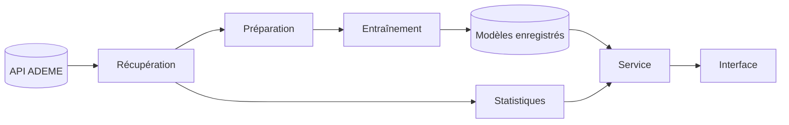

# Organisation de l'application

## Objectif

Récupérer les diagnostics de performance énergétique (DPE) publiés par l'ADEME, les analyser, faire des prédictions et afficher les résultats dans une application web.

## Les blocs

| Bloc | Rôle |
|---|---|
| Récupération | Interroge l'API de l'ADEME et enregistre les données avec leur date |
| Préparation | Nettoie et met en forme les données |
| Statistiques | Calcule les indicateurs descriptifs |
| Modèles | Prédisent une catégorie (classification) ou une valeur (régression) |
| Entraînement | Entraîne les modèles et les enregistre |
| Service | Point d'accès unique entre l'interface et le reste |
| Interface | Pages Streamlit : affichage et saisie |

## Fonctionnement

- **L'entraînement se fait à part**, manuellement, une fois par an ou en cas de changement de méthode du DPE. L'application charge des modèles déjà prêts, ce qui la rend rapide.
- **Les données peuvent être mises à jour à tout moment** par un nouvel appel à l'API.
- **L'interface ne fait qu'afficher.** Les calculs sont réalisés en dehors.

## Choix principaux

- **Séparation interface / calculs** : on peut modifier l'une sans casser l'autre.
- **Historique** : chaque jeu de données et chaque modèle est daté, on peut revenir à une version précédente.
- **Paramétrable** : les variables à prédire sont définies dans un fichier de configuration, pas dans le code.
- **Docker** : l'application est livrée avec tout ce dont elle a besoin, pour fonctionner à l'identique en local et en ligne.

Diagramme technique détaillé : [diagramme_classes.md](diagramme_classes.md).
