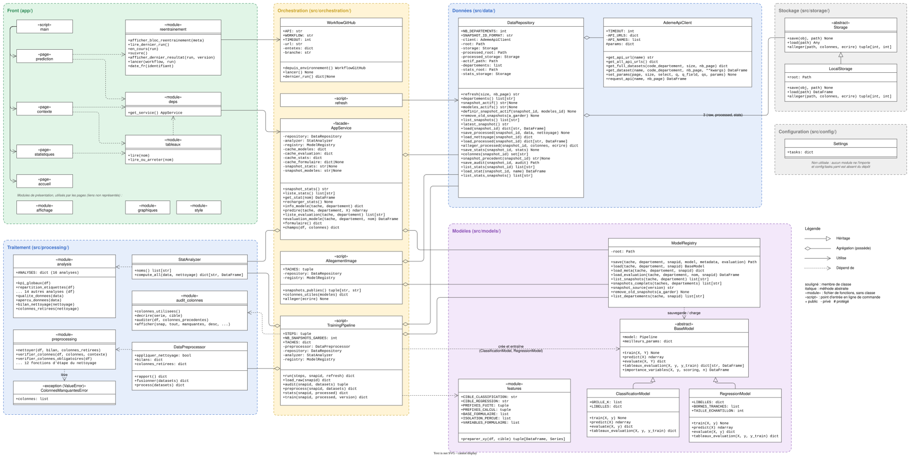

# Diagramme de classes - SISE-CONSO-ANALYSIS

Application Streamlit dockerisée d'analyse des DPE (API ADEME) : récupération des données, prétraitement, modèles de classification et de régression, statistiques descriptives.



## Rôle des classes

| Couche        | Classe                                    | Rôle                                                                                                                                         |
| ------------- | ----------------------------------------- | -------------------------------------------------------------------------------------------------------------------------------------------- |
| Config        | `Settings`                                | URLs de l'API, chemins, seuils, lecture de `config/tasks.yaml`                                                                               |
| Stockage      | `Storage` / `LocalStorage` / `S3Storage`  | Lecture et écriture des fichiers. Disque local aujourd'hui, stockage objet une fois en ligne                                                 |
| Données       | `AdemeApiClient`                          | Appels HTTP à l'API ADEME, sans logique métier. `get_dataset_info` lit la date de dernière mise à jour (`dataUpdatedAt`)                     |
| Données       | `DataRepository`                          | Crée des snapshots datés de données brutes, les liste et les recharge. Ne télécharge que si l'ADEME a publié une version plus récente        |
| Traitement    | `DataPreprocessor`                        | Fusion existant / neuf, suppression des colonnes vides, découpage train / test                                                               |
| Traitement    | `StatsAnalyzer`                           | Statistiques descriptives. Renvoie des DataFrames, jamais de graphiques                                                                      |
| Modèles       | `BaseModel`                               | Interface commune : `train`, `predict`, `evaluate`                                                                                           |
| Modèles       | `ClassificationModel` / `RegressionModel` | Métriques propres à chaque type de tâche                                                                                                     |
| Modèles       | `ModelRegistry`                           | Sauvegarde versionnée des modèles et de leurs métadonnées. `set_latest` désigne la version en service                                        |
| Orchestration | `TrainingPipeline`                        | Script hors application, lancé manuellement : snapshot, prétraitement, entraînement, sauvegarde                                              |
| Orchestration | `AppService`                              | Façade : seul point d'entrée du front vers le back. `check_compatibility` liste les colonnes attendues par le modèle et absentes du snapshot |
| Front         | `StreamlitApp` + pages                    | Affichage, widgets et graphiques uniquement                                                                                                  |

## Principes retenus

1. **Séparation back / front** : `src/` n'importe jamais Streamlit. Le back renvoie des `DataFrame`, `dict` ou `ndarray`. Les graphiques sont produits dans `app/`.
2. **Façade unique** : les pages ne connaissent que `AppService`, instancié une seule fois avec `@st.cache_resource`.
3. **Entraînement hors de l'application** : `TrainingPipeline` est lancé manuellement en ligne de commande, une fois par an ou après un changement de méthode du DPE (voir [procedure_reentrainement.md](procedure_reentrainement.md)). L'application ne fait que charger les modèles (lecture seule).
4. **Réapprovisionnement** : `DataRepository.refresh()` lit la date de mise à jour publiée par l'API (`dataUpdatedAt`) et ne télécharge que si elle est plus récente que le dernier snapshot. Le téléchargement se fait page par page (lien `next`). Il peut être déclenché depuis l'application ou par script. Les modèles ne sont pas réentraînés à cette occasion.
5. **Compatibilité modèle / données** : les données sont rafraîchies alors que le modèle reste figé. `AppService.check_compatibility()` compare les colonnes du snapshot à celles enregistrées dans `metadata.json` et l'interface affiche un avertissement en cas d'écart.
6. **Cibles configurables** : cible et estimateur sont définis dans `config/tasks.yaml`, pas dans le code. Les sujets de classification et de régression restent à définir.
7. **Héritage limité** : `BaseModel` (polymorphisme sur `evaluate`) et `Storage` (permet de changer de stockage lors de l'hébergement en ligne).

## Flux

```
[1] Rafraîchir   python -m src.refresh   API ADEME -> data/raw/<snapshot_id>/   (facultatif, voir [2])
[2] Entraîner    python -m src.train     snapshot -> prétraitement -> models/<version>/   (manuel, annuel)
                 Réutilise le dernier snapshot, télécharge seulement s'il n'y en a aucun.
                 --refresh : télécharge un nouveau snapshot   --snapshot <id> : utilise ce snapshot
[3] Servir       streamlit run app/main.py   dernier snapshot + dernier modèle, lecture seule
```

Contenu d'une version de modèle :

```
models/<version>/
  classifier.joblib    # pipeline sklearn complet (prétraitement + estimateur)
  regressor.joblib
  metadata.json        # snapshot utilisé, date, cible, colonnes attendues, métriques
models/latest          # nom de la version en service
```

## Arborescence cible

```
config/
  tasks.yaml
src/
  config.py              # Settings
  storage.py             # Storage, LocalStorage
  data/api_client.py     # AdemeApiClient
  data/repository.py     # DataRepository
  preprocessing.py       # DataPreprocessor
  analysis.py            # StatsAnalyzer
  models/base.py         # BaseModel
  models/classification.py
  models/regression.py
  models/registry.py     # ModelRegistry
  refresh.py             # point d'entrée [1]
  train.py               # TrainingPipeline, point d'entrée [2]
  service.py             # AppService
app/
  main.py                # StreamlitApp
  pages/data.py
  pages/stats.py
  pages/prediction.py
Dockerfile               # lance streamlit, data/ et models/ montés en volumes
```
