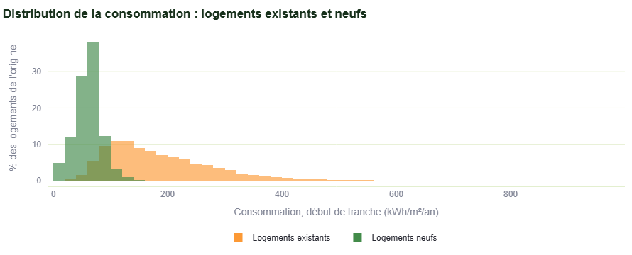
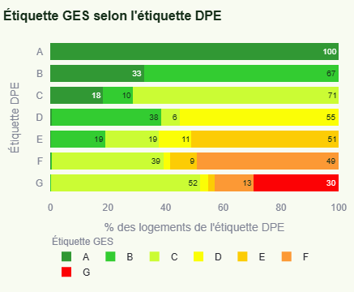

# Rapport d'étude

## 1. Introduction

### 1.1 Présentation des données

L'étude porte sur **388 833 logements** du Nord, du Rhône et de Paris, décrits par leur **diagnostic de performance énergétique (DPE)**.

### 1.2 Source et périmètre

Les DPE sont publiés en OpenData par l'**ADEME** et récupérés par son API. Chaque ligne décrit un logement : surface, année de construction, chauffage, isolation, consommation estimée et étiquette, de **A** (sobre) à **G** (énergivore).

L'échantillon compte 138 819 logements dans le Nord, 142 683 dans le Rhône et 107 331 à Paris, soit 297 016 logements existants et 91 817 neufs ; 79,5 % sont des appartements (de 57,9 % dans le Nord à 98,8 % à Paris). Le détail par département figure en **annexe A (tableau A.1)**.

### 1.3 Nettoyage des données

Les données ont été nettoyées avant analyse : **5 119 lignes sur 393 952** ont été écartées, soit 1,3 %. Chaque règle et sa justification sont détaillées sur le dépôt GitHub : [`docs/nettoyage_donnees.md`](https://github.com/Abrlh/SISE-CONSO-ANALYSIS/blob/master/docs/nettoyage_donnees.md).

### 1.4 Ce que l'on cherche à prédire

Deux grandeurs sont étudiées puis modélisées : l'étiquette (`etiquette_dpe`, de A à G) et la consommation des cinq usages en énergie finale (`conso_5_usages_par_m2_ef`, en kWh/m²/an), toutes deux définies dans [`src/models/features.py`](https://github.com/Abrlh/SISE-CONSO-ANALYSIS/blob/master/src/models/features.py#L5-L6).

### 1.5 Limites des données

Les chiffres décrivent **l'échantillon téléchargé**, et non l'ensemble du parc de logements : le téléchargement est **plafonné à 100 000 lignes** par jeu de données et par département, sans tirage aléatoire. Les DPE sont par ailleurs **déclaratifs**, d'où le nettoyage préalable.

## 2. Statistiques descriptives

La consommation médiane est de **132 kWh/m²/an** et **12,5 %** des logements sont des passoires thermiques. Ces deux chiffres recouvrent des situations très différentes, que la suite décompose : l'origine du logement, le département, les caractéristiques du logement, puis le lien avec les émissions de gaz à effet de serre. Les chiffres viennent des données nettoyées et des tableaux pré-calculés de l'application ([méthode de calcul](https://github.com/Abrlh/SISE-CONSO-ANALYSIS/blob/master/docs/analyses_des_donn%C3%A9es.md)). L'ensemble des statistiques et des graphiques est consultable sur l'application : [page Statistiques](https://sise-conso-analysis-mguj.onrender.com/statistiques)

### 2.1 Les indicateurs retenus

La médiane est préférée à la moyenne : quelques logements très énergivores tirent la moyenne à 156,3 kWh/m²/an, pour un écart-type de 101,3.

| Indicateur | Nord (59) | Rhône (69) | Paris (75) | Ensemble |
|---|---|---|---|---|
| Consommation médiane (kWh/m²/an) | 121 | 104 | **188** | 132 |
| Surface médiane (m²) | 68 | 64 | **42** | 60 |
| Passoires thermiques, F et G | 9,5 % | 6,7 % | **24,1 %** | 12,5 % |
| Logements performants, A et B | 12,4 % | 14,3 % | **5,5 %** | 11,2 % |

Paris se distingue sur chacun de ces indicateurs : les logements y sont les plus petits, les plus consommateurs, et près d'un sur quatre est une passoire thermique.

### 2.2 Logements existants et logements neufs

Les 297 016 logements existants ont une consommation médiane de **165 kWh/m²/an**, contre **62** pour les 91 817 logements neufs (distribution : **annexe B, figure B.1**). Leurs étiquettes ne se recouvrent presque pas (répartition complète : **annexe A, tableau A.2**).

- **41,6 % des logements neufs sont A ou B**, contre 1,7 % des existants ; aucun neuf n'est une passoire thermique, contre 16,4 % des existants. Les existants se concentrent sur C (25,0 %), D (33,1 %) et E (23,7 %), avec une longue queue vers les valeurs élevées, qui justifie l'usage de la médiane.

### 2.3 Des écarts entre départements

- **L'écart entre départements ne vient pas de la part de logements neufs.** Parmi les seuls existants, la médiane parisienne (199 kWh/m²/an) dépasse de 46 % celle du Rhône (136), et 26,1 % des logements parisiens existants sont des passoires, contre 9,7 % dans le Rhône.
- **Les logements neufs se ressemblent d'un département à l'autre**, de 56 à 65 kWh/m²/an, alors que les existants s'étalent de 136 à 199. L'écart entre départements ne se lit donc que sur les logements existants.

### 2.4 Ce qui fait varier la consommation

(Détail chiffré en **annexe A, tableau A.3**.)

- **L'isolation pèse lourd** : plus de la moitié des logements (208 208) ont des murs insuffisamment isolés et consomment en médiane 199,8 kWh/m²/an, soit trois fois plus que les logements très bien isolés (64). **La période de construction joue autant**, de 206 kWh/m²/an pour les logements de 1948-1974 à 62 pour ceux d'après 2021.
- **Les écarts sont également marqués selon la famille d'énergie** : 268 kWh/m²/an de médiane au fioul, 158 au gaz naturel, 118 à l'électricité. L'écart compare des logements qui diffèrent aussi par leur isolation et leur période de construction.
- **La surface n'explique presque pas la consommation au m²** : −0,11 dans la matrice de corrélation. Un grand logement consomme davantage au total, mais pas davantage par mètre carré.

### 2.5 Consommation et émissions de gaz à effet de serre

Chaque logement reçoit deux étiquettes : le **DPE** pour sa consommation, le **GES** pour ses émissions de gaz à effet de serre. La **figure B.2** (annexe B) croise les deux : chaque barre regroupe les logements d'une même étiquette DPE, ramenés à 100, et les répartit selon leur étiquette GES. Si les deux notes coïncidaient, chaque barre serait d'une seule couleur.

C'est le cas tout en haut : **100 % des logements classés A au DPE sont aussi A pour leurs émissions**. L'accord se défait ensuite, jusqu'à **30 % seulement pour G** : **52 % des logements classés G au DPE sont C** pour leurs émissions. Le décalage va toujours dans le même sens, vers de meilleures émissions.

Les deux étiquettes ne mesurent donc pas la même chose : le DPE compte l'**énergie primaire** consommée, le GES le carbone émis pour la produire.

# 3. Points communs entre les deux modèles

## 3.1 Les variables

Une fois les données brutes nettoyées, il reste environ **160 variables** (160 pour le Nord, 159 pour le Rhône, 156 pour Paris). Parmi ces dernières, nous retirons les colonnes contenant des informations pouvant biaiser ou être inutiles à nos prédictions : consommations, coûts, émissions, étiquette, adresses, dates et descriptions. Cela nous amène à **20 variables** qui seront celles présentes dans notre formulaire. Comme demandé dans le cahier des charges, une dernière variable issue d'un [jeu de données](https://france-chaleur-urbaine.beta.gouv.fr/carte?coord=2.3022994,48.8159318&zoom=9.52) d'open data a été rajoutée pour le département 59 uniquement : `reseau_chaleur_moins_de_100`. Les modèles du Nord utilisent donc **21 variables**.

## 3.2 Découpage des données

Nous entraînons **un modèle par département** (Nord, Rhône et Paris), avec 70 % des logements pour l'apprentissage et 30 % pour le test.

## 3.3 Sélection d'un modèle

Nous avons comparé et réglé les modèles sur **un seul département, le Nord (59)**. Il s'agit de l'un des deux départements possédant le plus de données. Nous nous sommes basés sur ces résultats pour construire les modèles des autres départements, en vérifiant que le réglage principal (l'encodage des variables qualitatives) améliore aussi le score dans le Rhône et à Paris.

# 4. Classification : prédire l'étiquette DPE d'un logement

Nous essayons de prédire `etiquette_dpe`.

## 4.1 Sélection du modèle

### 4.1.1 Méthodologie

Nous avons testé trois modèles : régression logistique, forêt aléatoire et gradient boosting. La régression logistique sert surtout de point de comparaison pour les deux autres.

Le prétraitement dépend de ce que chaque modèle accepte. Le gradient boosting ([`HistGradientBoostingClassifier`](https://scikit-learn.org/stable/modules/generated/sklearn.ensemble.HistGradientBoostingClassifier.html)) traite lui-même les valeurs manquantes et les variables qualitatives : chaque modalité est seulement remplacée par un entier ([`OrdinalEncoder`](https://scikit-learn.org/stable/modules/generated/sklearn.preprocessing.OrdinalEncoder.html)). C'est le prétraitement de l'application finale. Pour la régression logistique et la forêt aléatoire, les valeurs manquantes sont remplacées par la médiane (variables numériques) ou par la modalité la plus fréquente (variables qualitatives) avec [`SimpleImputer`](https://scikit-learn.org/stable/modules/generated/sklearn.impute.SimpleImputer.html). Les variables numériques sont ensuite centrées et réduites ([`StandardScaler`](https://scikit-learn.org/stable/modules/generated/sklearn.preprocessing.StandardScaler.html)), les variables qualitatives encodées en colonnes binaires ([`OneHotEncoder`](https://scikit-learn.org/stable/modules/generated/sklearn.preprocessing.OneHotEncoder.html)), et les colonnes constantes retirées ([`VarianceThreshold`](https://scikit-learn.org/stable/modules/generated/sklearn.feature_selection.VarianceThreshold.html)).

### 4.1.2 Résultats

Nous avons fait le choix d'utiliser le F1 macro principalement pour choisir notre modèle : nous sommes dans un problème de classification multiclasse, avec des données plutôt déséquilibrées.

| Modèle | F1 macro (test) | Précision macro (test) | Rappel macro (test) | Accuracy (test) | F1 macro (entraînement) | Durée d'entraînement (s) | Taille (Mo) |
|---|---|---|---|---|---|---|---|
| Régression logistique | 0.515 | 0.581 | 0.495 | 0.616 | 0.523 | 176 | 0.0 |
| Forêt aléatoire | 0.628 | 0.652 | 0.612 | 0.683 | 0.977 | 15 | 748.0 |
| Gradient boosting | 0.636 | 0.667 | 0.617 | 0.695 | 0.828 | 14 | 11.1 |

*tableau 1 : métriques des différents modèles*

Le rappel par étiquette est détaillé en **annexe A (tableau A.4)**.

La **régression logistique** est nettement en dessous (F1 macro 0,515 contre plus de 0,62), en précision comme en rappel, et sur toutes les étiquettes. Ses scores d'entraînement et de test sont proches : elle ne surapprend pas, elle est trop simple pour ces données. Un modèle non linéaire est justifié.

La **forêt aléatoire** a un F1 macro de 0,628 sur le test, très proche du gradient boosting (0,636, soit 0,008 d'écart). Elle garde l'avantage sur l'étiquette B (0,72 contre 0,64) et un peu sur F (0,29 contre 0,27). Mais son F1 d'entraînement est de 0,98 : avec les réglages par défaut, ses arbres retiennent presque toutes les lignes d'entraînement. C'est ce qui la rend lourde.

Le **gradient boosting** a le meilleur F1 macro, la meilleure précision, le meilleur rappel et la meilleure accuracy. Il est devant sur C, E et G. Son écart entraînement/test est bien plus faible (0,83 contre 0,64) et le modèle est près de 70 fois plus léger. Il s'entraîne aussi vite que la forêt aléatoire.

### 4.1.3 Interprétation

A priori, peu de différence entre forêt aléatoire et gradient boosting sur les tests du *tableau 1* : F1, précision, rappel et accuracy sont très proches. Néanmoins, nous observons un écart plus important au niveau du F1-score d'entraînement. Cet écart s'explique par le surapprentissage : la forêt aléatoire retient presque toutes ses données d'entraînement (0,98), ce qui ne se retrouve pas sur le jeu de test. Le gradient boosting y est moins sensible.

Le *tableau A.4* montre que tous les modèles semblent avoir du mal à différencier les classes **F et G**. Ce sont aussi les classes les moins représentées dans nos données (6 % et 3 % des logements du Nord).

De façon générale, tous les modèles sont moyens : ils apprennent correctement et retournent majoritairement les bonnes classes. Le **modèle de gradient boosting** obtient le meilleur score, mais l'écart avec la forêt aléatoire reste faible. Un point qui n'est cependant pas négligeable et qui nous a amenés à le choisir est la taille de ce dernier. Pour des raisons techniques liées au stockage de notre application, la forêt aléatoire étant bien trop volumineuse (748 Mo pour un .joblib), elle n'était pas envisageable comparée au gradient boosting (11 Mo). L'application garde un modèle par département, les modèles sont enregistrés dans le dépôt Git à chaque réentraînement (GitHub refuse les fichiers de plus de 100 Mo) et chargés en mémoire par l'application déployée (limite de 512 Mo de mémoire).

## 4.2 Gradient boosting

### 4.2.1 Optimisation des paramètres avant l'entraînement

Avec un encodage one-hot, les 21 variables du Nord deviennent environ 370 colonnes. Beaucoup de ces colonnes correspondent à des modalités rares, qui peuvent ajouter du bruit et du temps de calcul. Nous avons d'abord testé une sélection de colonnes (SelectKBest), qui note chaque colonne séparément avec un test ANOVA et garde les k mieux notées. Garder toutes les colonnes donnait toujours le meilleur score (F1 macro de validation de 0,47 pour k = 20, 0,57 pour k = 50 et 0,60 pour toutes) : cette étape a été abandonnée.

Le gradient boosting de scikit-learn sait traiter directement les variables qualitatives et les valeurs manquantes. Chaque modalité est alors simplement remplacée par un entier, et chaque variable reste une seule colonne. Nous avons comparé ce réglage à l'encodage one-hot, ainsi que deux autres paramètres : le nombre maximal d'itérations et la pondération des classes (**annexe A, tableau A.5**).

L'encodage natif améliore le score (F1 macro de 0,636 contre 0,613 en one-hot) tout en étant bien plus rapide (14 s contre 90 s) : il était essentiel pour améliorer le temps d'exécution de notre modèle. Ce gain se retrouve dans les deux autres départements (F1 macro de 0,603 à 0,633 dans le Rhône, de 0,584 à 0,619 à Paris). Avec un plafond de 1000 itérations, le modèle s'arrête de lui-même quand son score ne progresse plus (168 itérations). La pondération des classes n'a pas été retenue : elle améliore le rappel des classes rares, mais fait baisser le F1 macro (0,607). Cette méthode présente des limites : les autres paramètres du modèle (taille des arbres, pas d'apprentissage) n'ont pas été comparés.

### 4.2.2 Fiabilité

La matrice de confusion (**annexe B, figure B.3**) montre que la difficulté de prédiction intervient entre les classes **E, F et G**. En effet, même si 69.5 % des étiquettes sont exactes, 96.3 % des étiquettes sont exactes ou appartiennent à une classe voisine.

Globalement, nous avons une, grand maximum deux classes d'écart : l'écart entre une étiquette et l'autre n'est pas toujours évident et cela peut se justifier à l'échelle d'un consommateur : les métriques proposées sont très simples et ne sont pas aussi précises que les variables utilisées dans le réel calcul de l'étiquette DPE.

### 4.2.3 Importance des variables

Importance par permutation : ce que le modèle utilise. Sur 5 000 logements du test, on mélange au hasard les valeurs d'une variable, ce qui casse son lien avec l'étiquette, et on mesure la baisse du F1 macro. On répète 3 fois par variable et on fait la moyenne. Une forte baisse signifie que le modèle s'appuie sur cette variable (**annexe A, tableau A.6**).

Dans notre cas, une variable se détache : `annee_construction` (0,211). Trois variables ont une importance supérieure à 0.1 : `annee_construction`, `qualite_isolation_enveloppe` (0,117) et `type_energie_n1` (0,117). Ces résultats semblent cohérents avec la réalité terrain.

## 4.3 Conclusion

Le modèle choisi répond aux critères demandés, à savoir qu'il est léger et fournit des résultats satisfaisants. Les écarts calculés n'étant que d'une classe ou deux, nous pouvons conclure qu'ils n'auront donc que très peu d'impact sur la qualité prédictive. Dans un cadre où nous disposions davantage de ressources, une recherche plus complète des paramètres du modèle aurait probablement été envisagée.

# 5. Régression : prédire la consommation d'un logement

L'objectif est d'estimer la consommation d'énergie finale d'un logement, en kWh/m²/an (`conso_5_usages_par_m2_ef`).

## 5.1 Quel modèle choisir ?

La comparaison se fait face à un modèle de référence **baseline** qui prédit toujours la consommation médiane.

| Modèle | R² | MAE (kWh/m²/an) | Temps d'entraînement |
|---|---|---|---|
| Baseline (médiane)* | -0,07 | 74,2 | — |
| Régression linéaire | 0,34 | 32,7 | 14 s |
| Ridge | 0,33 | 32,6 | 7 s |
| Forêt aléatoire | 0,89 | 18,2 | 349 s |
| **Gradient boosting** | **0,95** | **13,3** | **8 s** |

*\* la Baseline est évaluée sur le jeu de test et les autres modèles par validation croisée à 3 plis sur le jeu d'apprentissage, avant réglage.*

Le **R²** indique la part de la variation de consommation que le modèle explique (1 = parfait), la **MAE** est l'erreur moyenne et le **RMSE** est du même ordre mais pèse davantage les grosses erreurs.

- Les modèles linéaires restent faibles : le chauffage, l'isolation et la surface interagissent au lieu de s'additionner.
- La forêt aléatoire fait bien mieux, mais avec un temps d'exécution énorme.
- Le **gradient boosting** fait encore mieux et s'entraîne environ 40 fois plus vite. Il accepte aussi les valeurs manquantes, alors que les autres modèles reçoivent des données imputées et encodées en one-hot. C'est lui que nous retenons.

Avec une grille de 8 combinaisons, on retient un `learning_rate` de 0.1, avec 31 feuilles maximum et 50 échantillons minimum par feuille. Toutes ces combinaisons donnent presque le même score (R² de 0,951 à 0,952) : le modèle est peu sensible à ces réglages. Sur le jeu de test, il atteint un R² de 0,953 et une MAE de 11,4, quasi identiques à la validation croisée (0,952) : le modèle généralise à des logements qu'il n'a jamais vus, il ne les mémorise pas. Sur la **figure B.4** (annexe B), plus les points se rapprochent de la diagonale, plus la prédiction est juste.

## 5.2 Un score trop beau pour être vrai

Ce R² de 0,95 est trompeur. L'importance des variables obtenue par permutation (on mélange une colonne et on regarde de combien le R² baisse) montre que la **surface** (0,56) et les **`deperditions_*`** (0,30 pour l'enveloppe) dominent (**figure B.5**, annexe B). Alors que ces **`deperditions_*`** sont des **résultats intermédiaires du calcul du DPE**, le diagnostiqueur les obtient après avoir mesuré le logement, et un particulier ne peut pas les saisir.

Nous avons donc retiré des variables par étapes. D'abord les **13 variables de calcul** du DPE (de 64 à 51), puis **31 détails techniques** (surfaces desservies par chaque installation, inertie du bâtiment, nombre de logements de l'immeuble...) qu'un particulier ne connaît pas et dont l'importance est inférieure à 0,015 (de 51 à 20). Il reste les **20 variables du formulaire**.

*Résultats sur le jeu de test du Nord.*

| Variables utilisées | Nombre | R² | MAE (kWh/m²/an) |
|---|---|---|---|
| Toutes | 64 | 0,953 | 11,4 |
| Sans les variables de calcul du DPE | 51 | 0,836 | 24,2 |
| **Formulaire (14 variables + 6 d'isolation estimée)** | **20** | **0,817** | **26,0** |
| Formulaire sans isolation | 14 | 0,718 | 32,7 |

Les variables de calcul **doublent l'erreur** (11,4 contre 24,2) : la performance réaliste d'une page destinée aux particuliers est donc plutôt de 0,82. Passer de 51 à 20 variables ne coûte presque rien (0,02 de R²), alors que l'estimation de la **qualité d'isolation** apporte à elle seule +0,10. Nous la gardons, tout en sachant qu'elle reste une estimation de l'utilisateur.

## 5.3 Résultats des modèles retenus

| Département | Lignes de test | R² | MAE | MAE naïve | RMSE |
|---|---|---|---|---|---|
| Nord (59) | 41 646 | 0,82 | 25,2 | 73,5 | 41,2 |
| Rhône (69) | 42 805 | 0,83 | 20,8 | 59,7 | 34,4 |
| Paris (75) | 32 200 | 0,69 | 41,3 | 81,6 | 60,3 |

*Pour le Nord, ces chiffres diffèrent légèrement de ceux du notebook (sections 1 et 2), le modèle en production est entraîné sur des lignes un peu différentes (97 173 lignes d'entraînement contre 97 164).*

Dans le Nord et le Rhône, le modèle se trompe en moyenne **trois fois moins** que la baseline, et deux fois moins à Paris.

Pour ces modèles du formulaire (20 variables), l'âge du logement, sa surface et son isolation pèsent le plus dans les trois départements (**annexe A, tableau A.7**). L'année de construction domine dans le Nord (0,30) et le Rhône (0,45), alors qu'à Paris l'isolation des combles (0,25) passe devant, et que l'énergie secondaire pèse nettement plus (0,18 contre 0,07 et 0,08).

L'erreur grandit avec la consommation : de 11 à 13 kWh/m²/an sous 100 (environ 20 à Paris), de 58 à 65 entre 300 et 400, plus de 119 au-delà de 400. Le modèle **surestime** légèrement les petites consommations et **sous-estime fortement** les grosses (jusqu'à -121 kWh/m²/an) : ces logements sont rares et très variés, donc difficiles à apprendre. **Paris** est le département le plus délicat : 15,7 % de ses logements de test dépassent 300 kWh/m²/an, contre 7,9 % dans le Nord et 4,5 % dans le Rhône.

## 5.4 Prise de recul

- **Un modèle utilisable plutôt que le plus précis.** Nous avons retenu le modèle du formulaire (R² de 0,82) plutôt que celui à 0,95, que personne ne pourrait renseigner.
- **Réglages choisis sur un seul département.** Ils ont été repris tels quels pour Paris et le Rhône. Le moins bon résultat de Paris (R² de 0,69) peut en partie venir de là : des réglages propres à ce département n'ont pas été testés.
- **L'isolation est une estimation de l'utilisateur**, moins fiable que la valeur calculée par un diagnostiqueur : la performance réelle sera un peu inférieure à celle mesurée.
- **La cible est une consommation conventionnelle**, issue de la méthode réglementaire du DPE et non d'un compteur : le modèle apprend à reproduire ce calcul.
- **Pistes d'amélioration** : guider l'estimation de l'isolation par des questions simples, et tester un modèle sur le logarithme de la consommation pour réduire la sous-estimation des valeurs élevées (non testé).

---

# Annexes

## Annexe A : Tableaux

### Tableau A.1 : Présentation des données par département (section 1.2)

| Département | Logements | Existants | Neufs | Appartements |
|---|---|---|---|---|
| Nord (59) | 138 819 | 99 173 | 39 646 | 57,9 % |
| Rhône (69) | 142 683 | 98 919 | 43 764 | 86,1 % |
| Paris (75) | 107 331 | 98 924 | 8 407 | 98,8 % |
| **Ensemble** | **388 833** | **297 016** | **91 817** | **79,5 %** |

### Tableau A.2 : Répartition des étiquettes DPE, existants et neufs (section 2.2)

| Étiquette | A | B | C | D | E | F | G |
|---|---|---|---|---|---|---|---|
| Logements existants | 0,3 % | 1,4 % | 25,0 % | **33,1 %** | 23,7 % | 9,9 % | 6,5 % |
| Logements neufs | 19,6 % | 22,0 % | **58,0 %** | 0,3 % | 0 % | 0 % | 0 % |
| Ensemble | 4,9 % | 6,3 % | 32,8 % | 25,4 % | 18,1 % | 7,5 % | 5 % |

### Tableau A.3 : Consommation médiane selon quelques caractéristiques (section 2.4)

| Caractéristique | Valeur | Logements | Consommation médiane |
|---|---|---|---|
| Isolation des murs | Insuffisante | 208 208 | **199,8** |
| | Très bonne | 76 807 | **64** |
| Période de construction | 1948-1974 | 78 629 | 206 |
| | Après 2021 | 69 574 | 62 |

### Tableau A.4 : Score de rappel par étiquette et par modèle (section 4.1.2)

| Étiquette | Régression logistique | Forêt aléatoire | Gradient boosting |
|---|---|---|---|
| A | 0.85 | 0.94 | 0.93 |
| B | 0.32 | 0.72 | 0.64 |
| C | 0.81 | 0.82 | 0.84 |
| D | 0.63 | 0.68 | 0.69 |
| E | 0.45 | 0.48 | 0.52 |
| F | 0.14 | 0.29 | 0.27 |
| G | 0.26 | 0.35 | 0.42 |

### Tableau A.5 : Résultats obtenus pour les réglages du gradient boosting (section 4.2.1)

| Réglage | F1 macro (test) | Accuracy (test) | Durée d'entraînement (s) |
|---|---|---|---|
| Modèle retenu (encodage natif, 1000 itérations max) | 0.636 | 0.695 | 14 |
| Encodage one-hot, 100 itérations | 0.613 | 0.682 | 90 |
| Modèle retenu avec 100 itérations | 0.632 | 0.692 | 10 |
| Modèle retenu avec pondération des classes | 0.607 | 0.638 | 8 |

### Tableau A.6 : Importance des variables par permutation, classification (section 4.2.3)

| Variable | Importance | Écart-type |
|---|---|---|
| annee_construction | 0.211 | 0.008 |
| qualite_isolation_enveloppe | 0.117 | 0.004 |
| type_energie_n1 | 0.117 | 0.002 |
| surface_habitable_logement | 0.099 | 0.003 |
| type_generateur_n1_ecs_n1 | 0.088 | 0.007 |

### Tableau A.7 : Variables les plus importantes par département, régression (section 5.3)

| Département | 1re | 2e | 3e | 4e |
|---|---|---|---|---|
| Nord (59) | année de construction (0,30) | surface (0,14) | isolation de l'enveloppe (0,12) | isolation des combles (0,10) |
| Rhône (69) | année de construction (0,45) | isolation des combles (0,16) | surface (0,13) | isolation des murs (0,10) |
| Paris (75) | isolation des combles (0,25) | surface (0,20) | année de construction (0,19) | énergie secondaire (0,18) |

## Annexe B : Figures

### Figure B.1 : distribution de la consommation, logements existants et logements neufs (section 2.2)

### Figure B.2 : répartition des étiquettes GES (gaz à effet de serre) à l'intérieur de chaque étiquette DPE (section 2.5)

### Figure B.3 : matrice de confusion du modèle de gradient boosting (section 4.2.2)

### Figure B.4 : consommation prédite contre consommation réelle (modèle complet, Nord, jeu de test) (section 5.1)

### Figure B.5 : importance des variables par permutation (modèle complet, Nord) (section 5.2)

